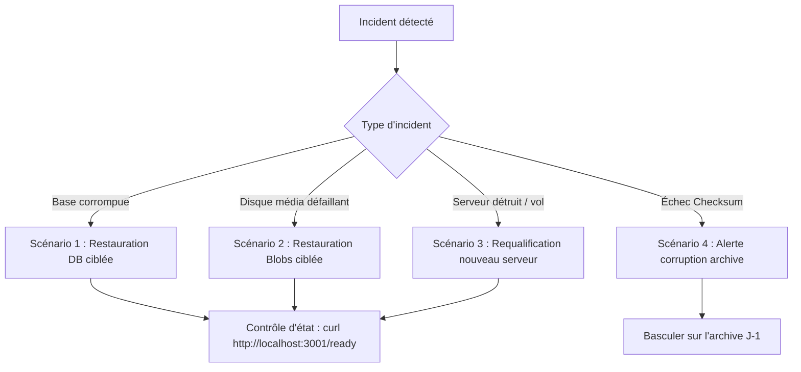

# Runbook d'exploitation : Sauvegarde et Restauration (PCA / PRA)

> **Statut : Validé — Couche 7 (Lot L6).** Date : 2026-11-16.  
> Référence : [ADR-0005](../17-decisions/ADR-0005-multi-tenant-et-hebergement.md), [§K.9 Architecture de sécurité](../10-securite/architecture-securite.md), [Plan de déploiement](plan-deploiement.md).

---

## 1. Objectifs et indicateurs de résilience (SLA)

BuildNote fonctionne selon un modèle d'instance dédiée par établissement déployée sur infrastructure locale (on-premise). La politique de continuité et reprise d'activité garantit la préservation intégrale du patrimoine académique.

| Indicateur | Cible | Description |
|---|---|---|
| **RPO** (Perte de données max) | **$\le$ 24 heures** | Sauvegarde quotidienne planifiée la nuit à 02h00. Les fiches saisies hors-ligne restent sur l'appareil enseignant jusqu'à synchronisation. |
| **RTO** (Délai de rétablissement) | **$\le$ 4 heures** | Temps de remise en service complète sur serveur de secours ou après réinitialisation matérielle. |
| **Chiffrement au repos** | **AES-256-CBC** | Toutes les archives de sauvegarde sont chiffrées avec dérivation de clé PBKDF2 (100 000 itérations). |
| **Intégrité** | **SHA-256** | Chaque archive est scellée par une empreinte cryptographique vérifiée avant toute tentative de restauration. |
| **Rétention** | **30 jours** | 30 archives journalières glissantes + archivage mensuel recommandé sur support externe déconnecté. |

---

## 2. Procédure de sauvegarde automatisée

### 2.1 Configuration de la clé de chiffrement
Dans le fichier `.env` de production de l'établissement :
```bash
# Clé de chiffrement symétrique des sauvegardes (64 caractères hexadécimaux recommandés)
BACKUP_ENCRYPTION_KEY=a1b2c3d4e5f6...votre_cle_secrete_ultra_robuste...
```

> [!CAUTION]
> **Règle vitale** : La clé `BACKUP_ENCRYPTION_KEY` doit être conservée dans un coffre-fort physique (enveloppe scellée chez le chef d'établissement) et dans le gestionnaire de mots de passe de l'administrateur système. Sans cette clé, aucune archive ne pourra être déchiffrée en cas de sinistre.

### 2.2 Automatisation par tâche planifiée (cron)
Sur le serveur Linux hébergeant l'instance, planifier l'exécution quotidienne via crontab (`crontab -e`) :
```cron
# Sauvegarde BuildNote chaque nuit à 02h00
0 2 * * * cd /opt/buildnote && ./scripts/backup-etablissement.sh >> /var/log/buildnote-backup.log 2>&1
```

### 2.3 Exécution manuelle
```bash
cd /opt/buildnote
./scripts/backup-etablissement.sh
```

L'archive résultante est stockée dans `./backups/buildnote_YYYYMMDD_HHMMSS.tar.gz.enc` accompagnée de son scellement `.sha256`.

---

## 3. Procédure de restauration pas-à-pas

### 3.1 Vérification et restauration standard
Pour restaurer une sauvegarde sur le serveur en production :

```bash
cd /opt/buildnote
./scripts/restore-etablissement.sh ./backups/buildnote_20261116_020000.tar.gz.enc
```

Le script exécute automatiquement les étapes suivantes :
1. **Contrôle d'intégrité SHA-256** : compare l'empreinte calculée avec le scellement `.sha256`. Si le fichier a été altéré ou corrompu, la restauration est immédiatement stoppée.
2. **Déchiffrement AES-256-CBC** : invite l'administrateur à saisir la clé (ou utilise `BACKUP_ENCRYPTION_KEY` si exportée).
3. **Affichage du manifeste** : présente la version, l'horodatage et les hashes des composants archivés.
4. **Confirmation de sécurité** : demande confirmation explicite (`OUI`) avant toute modification en base.
5. **Restauration de la base de données** : applique le dump via `pg_restore --clean --if-exists`.
6. **Restauration des médias Raw** : extrait les documents sources et photos de fiches dans `.data/blobs`.

### 3.2 Restauration non interactive (mode script / reprise automatique)
```bash
BACKUP_ENCRYPTION_KEY="votre_cle" ./scripts/restore-etablissement.sh ./backups/archive.tar.gz.enc --force
```

---

## 4. Scénarios d'incidents et fiches réflexes



### Scénario 1 : Corruption de la base de données PostgreSQL
1. Stopper l'API pour éviter les écritures concurrentes :
   ```bash
   docker compose stop api
   ```
2. Restaurer la dernière sauvegarde valide :
   ```bash
   ./scripts/restore-etablissement.sh ./backups/derniere_sauvegarde.tar.gz.enc --force
   ```
3. Redémarrer l'API et vérifier la connectivité :
   ```bash
   docker compose start api
   curl -f http://localhost:3001/ready
   ```

### Scénario 2 : Panne du stockage des médias (images et fiches Raw)
1. Recréer le volume de stockage local ou MinIO :
   ```bash
   mkdir -p .data/blobs && chmod 700 .data/blobs
   ```
2. Restaurer l'archive la plus récente.
3. Vérifier l'accès à une capture depuis l'interface web.

### Scénario 3 : Sinistre total (perte ou destruction du serveur)
1. Provisionner un nouveau serveur Ubuntu 22.04 LTS ou Debian 12 avec Docker.
2. Cloner le dépôt et exécuter le script d'installation :
   ```bash
   git clone https://github.com/14Case/BuildNote.git /opt/buildnote
   cd /opt/buildnote
   ./scripts/install-etablissement.sh
   ```
3. Récupérer la dernière archive chiffrée depuis le support externe / cloud souverain.
4. Restaurer les données :
   ```bash
   ./scripts/restore-etablissement.sh /chemin/archive.tar.gz.enc --force
   ```
5. Valider la santé globale via `http://localhost:3001/ready`.

---

## 5. Calendrier de tests et maintien en conditions opérationnelles

- **Chaque jour à 02h00** : exécution automatique de la sauvegarde chiffrée.
- **Chaque semaine** : copie miroir chiffrée de la dernière archive vers un disque externe physique ou serveur de réplication distant.
- **Chaque mois (1er lundi du mois)** : **test de restauration à blanc** sur un environnement de test isolé pour valider que les archives sont lisibles, intègres et déchiffrables avec la clé en vigueur.
